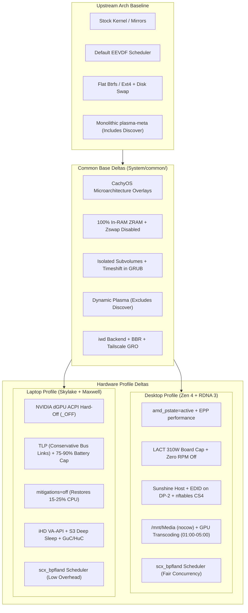

# Arch-Config: Opinionated Architecture & Delta Specification

> [!NOTE]
> This document specifies the **opinionated deltas from upstream Arch Linux defaults** that are actively maintained in this repository and deployed to live systems (optimal as of October 2026). It records the technical rationale for each divergence and catalogs explored and abandoned alternatives to prevent future regression. It is not an immutable standard and will continue to evolve alongside upstream kernel, Arch Linux, and CachyOS developments.

---

## 1. Architectural Model & Profile Boundaries

A standard Arch Linux installation provides a blank slate: an upstream Arch kernel, default EEVDF CPU scheduling, standard package mirrors, default sysctl settings, conventional disk swap, and unconfigured hardware power states.

This repository enforces an opinionated system topology orchestrated declaratively via `pyinfra` under `System/`:

---

## 2. Common Baseline Deltas (`System/common/`)

These deltas apply system-wide to every machine, diverging deliberately from upstream Arch Linux defaults.

### 2.1 Package Repositories, Toolchain & Desktop Modularisation
- **CachyOS Microarchitecture Overlays**:
  - *Delta from Upstream*: Rather than relying purely on standard generic `x86_64` Arch mirrors, CachyOS microarchitecture repositories are layered directly into `/etc/pacman.conf` (`x86_64_v4` / `cachyos-znver4` for Zen 4 Desktop, `x86_64_v3` / `cachyos-v3` for Skylake Laptop).
  - *Rationale*: CachyOS packages are built with `-O3`, Link-Time Optimisation (LTO), Profile-Guided Optimisation (PGO), and modern CPU instruction targets, delivering 5–15% performance uplift in compute-bound workloads, shader compilation, and gaming 1% low frame times.
  - *LizardByte Repository*: `[lizardbyte]` with `SigLevel = Optional` provides precompiled, signed binary releases for Sunshine host streaming.
- **Dynamic Plasma Dependency Resolution (Excluding Discover)**:
  - *Delta from Upstream / Meta Packaging*: Instead of hardcoding static package lists or installing the monolithic `plasma-meta` bundle, `System/common/packages.py` dynamically resolves all upstream direct dependencies of `plasma-meta` at deployment time and excludes `discover`.
  - *Rationale*:
    - **CLI Package Management Preference**: All package installations and system maintenance are intentionally executed via the command line using `pacman` and `yay` (orchestrated declaratively via `pyinfra`), rendering a graphical software store redundant.
    - **Resource & Process Cleanliness**: Eliminates unnecessary GUI background daemons, Flatpak/appstream metadata fetch processes, and desktop notification overhead.
    - **Zero Maintenance**: Dynamic dependency resolution ensures the desktop environment stays current with all official upstream KDE Plasma components across future point updates without manual list maintenance, while keeping `discover` permanently excluded.
- **Makepkg Compilation Tuning (`/etc/makepkg.conf`)**:
  - *Delta from Upstream*: Overrides default makepkg settings with:
    - `CFLAGS`: `-march=native -O2 -pipe -fno-plt -fexceptions -Wp,-D_FORTIFY_SOURCE=3 -Wformat -Werror=format-security -fstack-clash-protection -fcf-protection -fno-omit-frame-pointer -mno-omit-leaf-frame-pointer`
    - `MAKEFLAGS="-j$(nproc)"`
    - `BUILDDIR=/tmp/makepkg`
    - `COMPRESSZST=(zstd -c -z -q -T0 -3 -)`
    - `RUSTFLAGS="-C target-cpu=native"`
  - *Rationale*: Compiles AUR packages targeting the native host CPU while preserving frame pointers (`-fno-omit-frame-pointer`) for system tracing and eBPF profiling. Building on `tmpfs` (`/tmp/makepkg`) reduces NVMe write wear and accelerates linking.

### 2.2 Storage, Btrfs Subvolume Layout & Maintenance
- **Six-Subvolume Isolation Topology**:
  - *Delta from Upstream*: Instead of a single root partition or a basic `@` and `@home` layout, storage is partitioned into six isolated subvolumes:
    - `@` -> `/`
    - `@home` -> `/home`
    - `@pkg` -> `/var/cache/pacman/pkg`
    - `@log` -> `/var/log`
    - `@.snapshots` -> `/.snapshots`
    - `@games` -> `/home/$USER/Games`
  - *Rationale*:
    - Isolating `@pkg` and `@log` prevents pacman download caches and systemd journals from bloating root snapshots.
    - Isolating `@games` ensures multi-gigabyte Steam/Lutris game installations are excluded from system rollbacks, preventing snapshot exhaustion during kernel restorations.
- **Btrfs Mount Parameters**:
  - *Delta from Upstream*: `rw,noatime,compress=zstd:3,ssd,discard=async,space_cache=v2`.
  - *Rationale*: `noatime` eliminates metadata write churn on file reads. `compress=zstd:3` maximizes transparent disk bandwidth without measurable CPU overhead. `discard=async` performs continuous background TRIM without the latency stalls of synchronous `discard`.
- **Automated Snapshot Booting**:
  - *Delta from Upstream*: GRUB with `grub-btrfsd --syslog --timeshift-auto` drop-in override; `31_efi_bootnext` made non-executable.
  - *Rationale*: Automatically generates bootable GRUB menu entries whenever Timeshift creates a snapshot. Disabling `31_efi_bootnext` eliminates cluttered firmware boot menu entries.
- **NVMe I/O Scheduling**:
  - *Delta from Upstream*: Kernel queue scheduler forced to `none` via udev (`/etc/udev/rules.d/60-iosched.rules`).
  - *Rationale*: NVMe SSDs utilize hardware-level multi-queue submission (`blk-mq`) on controller silicon. Software schedulers (`mq-deadline`, `bfq`) introduce unnecessary CPU latency.
- **Automated Btrfs Health, Scrub & Balance Maintenance**:
  - *Delta from Upstream*: Enables declarative systemd timers for `btrfs-scrub@-.timer` (weekly block checksum verification), `btrfs-balance.timer` (periodic chunk group reallocation), and `timeshift-hourly.timer` across all machines, plus `btrfs-scrub@mnt-Media.timer` on Desktop.
  - *Rationale*: Preemptively detects and repairs silent storage bitrot using Btrfs checksum verification without administrative intervention. Periodic chunk balancing reclaims empty allocation blocks, preventing false `ENOSPC` out-of-space errors on active dynamic volumes.

### 2.3 Memory Management & Sysctl Architecture
- **In-RAM Swap via ZRAM vs Physical Swap / Zswap**:
  - *Delta from Upstream*: Zero physical swap partitions or swapfiles. Standardised on `zram-generator` with `zstd` algorithm and `swap-priority = 100`. Kernel `zswap` explicitly disabled (`zswap.enabled=0`).
  - *Rationale*: Eliminates disk swap I/O latency and SSD write wear. Disabling `zswap` prevents double-compression and CPU contention between the kernel page cache compressor and ZRAM.
  - *Profile Sizing*:
    - **Desktop**: 100% of RAM (32GB virtual swap) provides vast headroom for concurrent 4K gaming, virtual machines, and video transcoding.
    - **Laptop**: 50% of RAM (8GB virtual swap on 16GB RAM) prevents memory exhaustion under burst mobile workloads.
- **Memory Tuning Sysctls (`/etc/sysctl.d/99-swappiness.conf`)**:
  - *Delta from Upstream*:
    - `vm.swappiness = 150`: Instructs the kernel to aggressively evict cold anonymous pages into fast ZRAM, preserving physical RAM for game binaries and filesystem caches.
    - `vm.page-cluster = 0`: Disables multi-page swap read-ahead; reads single 4KB pages to avoid wasted decompression cycles on random memory access.
    - `vm.max_map_count = 2147483642`: Required by modern memory-mapped Windows titles under Proton (*Star Citizen*, *Hogwarts Legacy*, *DayZ*).
    - `vm.watermark_scale_factor = 125`: Wakes background `kswapd` proactively before processes encounter blocking direct memory reclamation.
  - *CachyOS Settings Layer*:
    - `vm.watermark_boost_factor = 0`: Disables watermark boost spikes to eliminate stuttering "swap storms".
    - `vm.dirty_bytes = 268435456` (256MB) / `vm.dirty_background_bytes = 67108864` (64MB): Replaces percentage-based dirty ratios with absolute byte limits, preventing multi-gigabyte I/O flush freezes.

### 2.4 Networking, QoS & Connectivity
- **iwd Backend for NetworkManager**:
  - *Delta from Upstream*: `/etc/NetworkManager/conf.d/wifi_backend.conf` sets `wifi.backend=iwd`; `/etc/iwd/main.conf` sets `Country=GB`.
  - *Rationale*: `iwd` (Intel Wireless Daemon) uses fewer CPU cycles, connects up to 4x faster on boot, roams cleanly, and eliminates `wpa_supplicant` daemon overhead.
- **Wi-Fi Power Save Policy**:
  - *Delta from Upstream*: NetworkManager dispatcher `/etc/NetworkManager/dispatcher.d/disable-wifi-powersave` executes `iw dev $1 set power_save off`.
  - *Rationale*: 802.11 power saving puts the wireless radio into sleep states between beacon intervals, producing periodic 50–150ms latency spikes that degrade SSH responsiveness and game streaming.
- **TCP BBR & Network Queuing (`/etc/sysctl.d/99-bbr.conf`)**:
  - *Delta from Upstream*: Overrides default TCP CUBIC with `net.core.default_qdisc = fq`, `net.ipv4.tcp_congestion_control = bbr`, 16MB max buffers (`rmem_max`, `wmem_max`), `net.core.netdev_max_backlog = 10000`, and `net.ipv4.tcp_slow_start_after_idle = 0`.
  - *Rationale*: TCP BBRv3 model-based pacing eliminates bufferbloat. BBR requires Fair Queueing (`fq`) for packet pacing. Expanding backlog prevents packet drops during burst transfers; disabling slow start after idle maintains video streaming bitrates.
- **Tailscale Hardware GRO Offloading & Forwarding**:
  - *Delta from Upstream*: Dispatcher `/etc/NetworkManager/dispatcher.d/99-tailscale-gro` applies `ethtool -K $1 rx-udp-gro-forwarding on rx-gro-list off`. Sysctl `/etc/sysctl.d/99-tailscale.conf` enables IPv4/IPv6 forwarding.
  - *Rationale*: UDP Generic Receive Offload (GRO) passes WireGuard packet assembly to NIC hardware, reducing CPU usage and maximizing VPN throughput.
- **Bluetooth Peripheral Battery Telemetry (`/etc/bluetooth/main.conf`)**:
  - *Delta from Upstream*: Sets `Experimental = true` under `[General]`.
  - *Rationale*: Exposes experimental BlueZ D-Bus interfaces to allow continuous battery reporting and telemetry for Bluetooth peripheral devices (wireless gamepads, mice, keyboards, headsets) directly to KDE Plasma's status tray and UPower.
- **Reflector Dynamic HTTPS Mirror Refresh (`/etc/xdg/reflector/reflector.conf`)**:
  - *Delta from Upstream*: Automated mirrorlist maintenance enabled via `reflector.timer` with `--country GB,IE,NL,DE,FR --protocol https --latest 20 --sort score`.
  - *Rationale*: Continuously benchmarks and ranks nearest geographic HTTPS mirrors by connection rate and freshness, preventing stalled pacman sync operations without manual mirror curation.

### 2.5 Security, Credentials & Dynamic Windowing
- **Sudo Password Enforcement & Custom Prompt**:
  - *Delta from Upstream*: Sudo requires passwords with custom prompt `Defaults passprompt="Enter sudo password to continue: "` in `/etc/sudoers.d/custom_prompt`.
  - *Rationale*: Avoids ambiguous password prompt strings and preserves administrative boundaries.
- **Git Credential Helper**:
  - *Delta from Upstream*: Global configuration enforces `git config --global credential.helper libsecret`.
  - *Rationale*: Integrates Git token management securely into Freedesktop Secret Service (KWallet), avoiding plaintext tokens on disk.
- **Dynamic KWin Window Geometry Rules (`kwin_sync.zsh`)**:
  - *Delta from Upstream*: Window placement rules are dynamically generated by merging a shared rule fragment (`common.kwinrule.fragment`) with profile geometry templates (`desktop.rule.template` or `laptop.rule.template`).
  - *Rationale*: Enforces unified application window behaviours across devices while automatically adapting window sizes (Small, Tall, Wide, Boxy) to display resolutions (3440x1440p ultrawide vs 1080p 16:9).
- **Automated Initramfs & Bootloader Rebuild Hooks**:
  - *Delta from Upstream*: Pacman hook `/etc/pacman.d/hooks/98-rebuild-initramfs.hook` triggers `mkinitcpio -P` upon updates to CPU microcodes (`amd-ucode` on desktop, `intel-ucode` on laptop), `btrfs-progs`, `mkinitcpio-firmware`, or `linux-cachyos-headers`. Hook `/etc/pacman.d/hooks/99-update-grub.hook` triggers `grub-mkconfig` on `linux-cachyos` updates.
  - *Rationale*: Eliminates manual post-update bootloader synchronisation errors.
- **Realtime Audio Privileges & Scheduling (`realtime-privileges`)**:
  - *Delta from Upstream*: Deploys `realtime-privileges` package and assigns the user to the `realtime` group, configuring PAM limits `/etc/security/limits.d/99-realtime.conf` with `rtprio 98`, `nice -11`, and `memlock unlimited`.
  - *Rationale*: Grants PipeWire and WirePlumber real-time scheduling priority and locked memory allocations, eliminating audio buffer underruns (xruns) and audio pops under simultaneous heavy game rendering, Sunshine host encoding, or compilation.

---

## 3. Desktop Profile Deltas (Ryzen 7800X3D + RX 7900 XT)

Targeted for heavy gaming, Sunshine remote streaming host, and continuous media serving.

### 3.1 CPU Architecture & Scheduling Deltas
- **`amd_pstate=active`**:
  - *Delta*: Explicitly configured on GRUB kernel command line.
  - *Rationale*: Activates autonomous CPPC v3 frequency scaling on Zen 4 silicon, adapting clock frequencies at 1ms hardware intervals.
- **EPP `performance` Profile**:
  - *Delta*: `/etc/tmpfiles.d/amd-epp.conf` forces `performance` across all logical CPU cores (`w /sys/devices/system/cpu/cpu*/cpufreq/energy_performance_preference - - - - performance`).
  - *Rationale*: Eliminates core wake-up latency and frequency ramp lag during unpredictable burst gaming and concurrent Sunshine encoding.
- **Split Lock Mitigation Disable**:
  - *Delta*: `split_lock_detect=off` applied in GRUB.
  - *Rationale*: Prevents the Linux kernel from penalizing and throttling Windows games (*Ghost of Tsushima*, *Far Cry 6*, Unreal Engine titles) that execute split locks across cache lines.
- **Sched-ext: `scx_bpfland` Selection**:
  - *Delta*: Default kernel scheduler replaced with eBPF scheduler via `/etc/scx_loader/config.toml` (`default_sched = "scx_bpfland"`).
  - *Rationale*: The 7800X3D features a single CCD with uniform 96MB L3 cache access. `scx_bpfland` (vruntime fair scheduling) delivers superior fairness and consistency when running simultaneous game rendering, KMS frame capture, VA-API video encoding, and audio streaming without starvation.

### 3.2 GPU Power, Thermal & Acceleration Deltas (RX 7900 XT)
- **Power Capping & Junction Fan Curve (LACT)**:
  - *Delta*: Board power capped at 310.0W; custom junction fan curve (40°C: 20% -> 95°C: 100%) with `zero_rpm: false` enforced via `/etc/lact/config.yaml` and `lactd.service`.
  - *Rationale*: Keeps Navi 31 silicon within its peak efficiency envelope. Disabling Zero RPM prevents memory thermal soak (keeping GDDR6 VRAM at ~46°C idle).
- **PowerPlay Feature Mask**:
  - *Delta*: `amdgpu.ppfeaturemask=0xffffffff` applied on GRUB command line.
  - *Rationale*: Fully unlocks AMD PowerPlay feature masks, enabling LACT userspace control over fan curves, DPM states, and board power caps.
- **Initramfs KMS & LZ4 Compression**:
  - *Delta*: `MODULES=(amdgpu nvme)` and `COMPRESSION="lz4"` in `/etc/mkinitcpio.conf`.
  - *Rationale*: Early KMS eliminates display mode flickering during boot; LZ4 decompression on Zen 4 cores yields near-instantaneous initramfs extraction.
- **ROCm GPU Compute Stack**:
  - *Delta*: Installs `rocm-hip-runtime` and `rocm-opencl-runtime`.
  - *Rationale*: Enables hardware OpenCL and HIP compute acceleration for media tools and compute workloads on the RX 7900 XT without requiring proprietary AMDGPU-PRO packages.
- **Hardware Bus & Wi-Fi Stability Fixes**:
  - *Delta*:
    - `/etc/udev/rules.d/99-xhci-fix.rules`: Forces `power/control="on"` for AMD USB controller `0x1022:0x43f7`, preventing USB controller sleep that disconnects Logitech wireless receivers.
    - `/etc/modprobe.d/mt7921e.conf`: Sets `options mt7921e disable_aspm=Y`, preventing PCIe link-state wake timeouts that cause MediaTek MT7922 Wi-Fi firmware crashes.
    - `/etc/udev/rules.d/42-solaar-uinput.rules`: Grants `uaccess` to `/dev/uinput` and Logitech HID++ devices for userspace DPI and battery management.

### 3.3 Remote Streaming Architecture (Sunshine & nftables)
- **Headless User Lingering**:
  - *Delta*: Enabled via `/var/lib/systemd/linger/$USER`.
  - *Rationale*: Allows Sunshine and background services to initialize immediately on boot before an interactive Wayland session is opened.
- **Virtual Firmware EDID Injection**:
  - *Delta*: Injects `custom_sunshine.bin` onto display port `DP-2` via initramfs `FILES` and kernel parameter `drm.edid_firmware=DP-2:edid/custom_sunshine.bin`.
  - *Rationale*: Creates virtual display topologies (3440x1440@60, 2560x1440@120, 2560x1600@120) for headless streaming without physical monitors or HDMI dummy plugs.
- **Sunshine Capabilities & Service Override**:
  - *Delta*: Assigns `setcap cap_sys_admin+p` to the Sunshine binary; applies systemd override `/home/$USER/.config/systemd/user/app-dev.lizardbyte.app.Sunshine.service.d/override.conf` (`Restart=always`, `RestartSec=3s`).
  - *Rationale*: `cap_sys_admin` enables KMS display frame capture without root; systemd override prevents service crashes during display resolution changes.
- **Display Mode Helpers (`/usr/local/bin`)**:
  - *Delta*: Deploys `sunshine_res` (SDR scale 1.75), `sunshine_hdr` (HDR and WCG enable/disable via `kscreen-doctor`), `sunshine_laptop` (1080p), `sunshine_pixel` (1600x900), and `sunshine_configure`.
  - *Rationale*: Enables client devices to toggle host resolution, refresh rate, scaling, and HDR dynamically via Sunshine connection hooks.
- **nftables QoS (CS4 DSCP Tagging)**:
  - *Delta*: `/etc/nftables.conf` mangles Sunshine UDP/TCP packets on ports `47984-48010` with DSCP `cs4`.
  - *Rationale*: Signals upstream network switches and routers to prioritise video streaming packets over bulk downloads, preventing stream frame drops when background media downloads are active.

### 3.4 Media Server, Storage & Arr Stack (`/mnt/Media`)
- **Storage Topology & Mount Parameters**:
  - *Delta*: Dedicated Btrfs partition mounted at `/mnt/Media` with `rw,nosuid,nodev,noatime,nofail,x-gvfs-hide,x-systemd.automount,compress=zstd:3,discard=async`.
  - *Rationale*: Automount prevents boot delays if storage is unready; `x-gvfs-hide` prevents cluttering Dolphin file manager sidebars.
- **Copy-on-Write (CoW) Disabling (`chattr +C`)**:
  - *Delta*: `nocow` applied to `/var/lib/jellyfin` and `/mnt/Media/Downloads`.
  - *Rationale*: Torrent writes and SQLite database operations cause massive Btrfs fragmentation and write amplification. Disabling CoW maintains sequential read throughput.
- **RAM Disk Transcoding**:
  - *Delta*: `/etc/tmpfiles.d/jellyfin-transcode.conf` provisions `/dev/shm/jellyfin` (tmpfs RAM disk) for Jellyfin transcodes.
  - *Rationale*: Eliminates SSD write wear and I/O bottlenecks when transcoding multi-stream 4K HDR media.
- **Permissions Architecture**:
  - *Delta*: Enforces group `media` with SGID bit (`chmod 2775`) and POSIX default ACLs (`setfacl -R -m d:g:media:rwX`). Service drop-ins for `sonarr`, `radarr`, `prowlarr`, and `transmission-daemon` enforce `UMask=0002` and `RequiresMountsFor=/mnt/Media`.
  - *Rationale*: Guarantees seamless read/write interoperability across multiple service users and the primary desktop user without permission deadlocks.
- **Nightly Hardware-Accelerated Media Optimizer**:
  - *Delta*: Enables `media-optimizer.timer` (`OnCalendar=*-*-* 01:00:00`) running `/usr/local/bin/media_optimizer`.
  - *Rationale*: Executes daily maintenance between 01:00 and 05:00 to transcode H.264 / AVC video to space-saving HEVC using AMD hardware acceleration (`hevc_vaapi`, `-qp 24`, `/dev/dri/renderD128`).
- **Arr Stack, Seerr & Trawl Automation**:
  - *Delta*: Enables `jellyfin`, `transmission-daemon`, `sonarr`, `radarr`, `prowlarr`, `seerr`, `valkey`, and `trawl` user service.
  - *Rationale*: Provides an autonomous media acquisition and streaming stack backed by local caching and traffic management.

---

## 4. Laptop Profile Deltas (Dell XPS 9550)

Targeted for maximum power efficiency, battery longevity, and silent operation.

### 4.1 GPU Architecture: ACPI Hard-Off
- **NVIDIA dGPU Hardware Power Cut**:
  - *Delta*: Completely powers off the NVIDIA GTX 960M dGPU using `\_SB.PCI0.PEG0.PEGP._OFF` via `acpi_call-dkms`. Blacklists all `nouveau` and `nvidia*` kernel modules in `/etc/modprobe.d/disable-nvidia.conf`.
  - *Rationale*:
    - The Maxwell architecture GTX 960M dGPU lacks modern RTD3 (Runtime D3) power management. Standard driver blacklisting leaves PCIe power rails energized, burning 15–25W of continuous idle battery power.
    - Calling the ACPI method cuts electrical power at the hardware bus level, dropping idle battery drain from ~28W to ~7W.
- **Sleep & Wake Safety Hook**:
  - *Delta*: `/usr/lib/systemd/system-sleep/nvidia-acpi-off` calls `_ON` pre-suspend and `_OFF` post-resume.
  - *Rationale*: Putting the machine to sleep with the dGPU bus powered off causes ACPI firmware kernel panics on resume. Powering the bus on right before sleep and powering it down immediately upon resume ensures reliable S3 sleep cycles.

### 4.2 Power Management (TLP) & Battery Preservation
- **TLP Enforcement**:
  - *Delta*: Manages power via `tlp` and `tlp-rdw`. Replaces `power-profiles-daemon`, masks `systemd-rfkill.service` and socket, and disables `NetworkManager-wait-online.service`.
  - *Rationale*: TLP provides granular control over PCIe ASPM, SATA link power, and audio power management. `power-profiles-daemon` conflicts directly with TLP rules. Masking `systemd-rfkill` prevents race conditions with TLP radio state management.
- **Conservative Battery Link Policies**:
  - *Delta*: In `/etc/tlp.conf`:
    - `WIFI_PWR_ON_BAT=off`
    - `PCIE_ASPM_ON_BAT=default`
    - `NVM_ENERGY_PERF_POLICY_ON_BAT=default`
  - *Rationale*:
    - Enforcing aggressive ASPM and NVMe power saving on the XPS 9550 causes PCIe link dropouts and NVMe controller disconnects. Leaving ASPM and NVMe on `default` maintains stability.
    - Disabling Wi-Fi power saving prevents network latency jitter.
- **Battery Charge Threshold Enforcement**:
  - *Delta*: `/etc/udev/rules.d/99-battery-threshold.rules` sets `charge_control_start_threshold=75` and `charge_control_end_threshold=90` on `BAT0`.
  - *Rationale*: Operating lithium-ion cells at 100% continuous float voltage accelerates chemical degradation. Stopping charge at 90% and starting at 75% prolongs battery lifespan significantly.
- **Thermal Management**:
  - *Delta*: Enables `thermald.service`.
  - *Rationale*: Leverages Intel DPTF (Dynamic Platform and Thermal Framework) to prevent aggressive thermal throttling spikes on the Skylake chassis.

### 4.3 Intel Graphics, Video Acceleration & Kernel Tuning
- **Intel iHD VA-API Driver**:
  - *Delta*: Sets `LIBVA_DRIVER_NAME=iHD` for Intel Skylake HD Graphics 530.
  - *Rationale*: The modern `intel-media-driver` (iHD) provides superior hardware decoding support and lower CPU usage than the older `i965` driver.
- **Kernel Command Line Parameters**:
  - *Delta*: `split_lock_detect=off loglevel=3 quiet hugepages=512 i915.enable_fbc=1 i915.enable_guc=3 rcutree.enable_rcu_lazy=1 mitigations=off zswap.enabled=0 mem_sleep_default=deep`.
  - *Rationale*:
    - `mitigations=off`: **Deliberately enabled on Laptop (unlike Desktop).** 6th-gen Skylake mobile CPUs lack in-silicon speculative execution mitigations. Kernel software mitigations impose a massive 15–25% CPU overhead on older 4-core mobile hardware. Disabling them restores snappy desktop responsiveness on an isolated personal machine.
    - `i915.enable_fbc=1`: Framebuffer compression reduces memory bandwidth power draw.
    - `i915.enable_guc=3`: Offloads graphics scheduling and video parsing to Intel GuC/HuC firmware.
    - `rcutree.enable_rcu_lazy=1`: Batches RCU callbacks to keep CPU cores in low C-states on battery.
    - `mem_sleep_default=deep`: Enforces true S3 deep sleep, preventing connected-standby battery drain while in a laptop bag.
    - `hugepages=512`: Preallocates 1GB of 2MB hugepages for virtualization and reduced TLB overhead.
    - `zswap.enabled=0`: Disables redundant zswap compressor in favor of ZRAM.
- **mkinitcpio Configuration**:
  - *Delta*: Sets `MODULES=(i915 nvme)` and ensures `numlock` hook in `/etc/mkinitcpio.conf`.
  - *Rationale*: Early KMS for Intel display controller; `numlock` hook guarantees console keypad state.
- **Package Cache Pruning**:
  - *Delta*: Enables `paccache.timer`.
  - *Rationale*: Weekly cleanup of `/var/cache/pacman/pkg` retains only the latest 3 versions, conserving space on limited laptop storage.
- **Client Game Streaming**:
  - *Delta*: Installs `moonlight-qt`.
  - *Rationale*: Acts as a low-latency streaming client connected to the Desktop Sunshine host.
- **Intel Wi-Fi Aggregation & Power Scheme (`/etc/modprobe.d/iwlwifi.conf`)**:
  - *Delta*: Sets `options iwlwifi 11n_disable=8` and `options iwlmvm power_scheme=1`.
  - *Rationale*: `11n_disable=8` enables Tx AMSDU aggregation to achieve line-rate Wi-Fi throughput on Intel wireless hardware. `power_scheme=1` disables aggressive link power-down in `iwlmvm` that causes Wi-Fi ping spikes and dropouts on battery.
- **Sound Open Firmware (SOF) DSP Acceleration**:
  - *Delta*: Installs `sof-firmware`.
  - *Rationale*: Replaces legacy fallback audio drivers with modern Sound Open Firmware for the Skylake audio DSP, enabling low-power hardware audio decoding and pipeline offloading.

---

## 5. Explored & Abandoned Alternatives

Recording abandoned alternatives prevents future regressions or redundant investigations.

### 5.1 Desktop Explored & Rejected Alternatives
1. **CPU EPP `balance_performance`**:
   - *Attempt*: Evaluated `balance_performance` to lower idle package power from ~45W to ~15W.
   - *Result*: **Rejected.** Caused observable frame-time pacing jitter, audio pops, and frequency ramp latency during burst game transitions and concurrent Sunshine video encoding. Replaced with constant `performance`.
2. **CPU Mitigations Off (`mitigations=off`)**:
   - *Attempt*: Evaluated disabling mitigations to boost gaming frame rates.
   - *Result*: **Rejected.** Zen 4 features hardware-level silicon mitigations. Real-world gaming benchmarks showed **0% performance uplift** while unnecessarily exposing the system to browser and Proton sandbox escapes.
3. **GPU Undervolting**:
   - *Attempt*: Applied negative voltage offsets to the RX 7900 XT.
   - *Result*: **Rejected.** RDNA 3 silicon exhibits extreme voltage sensitivity; negative offsets produce driver timeouts and ring crashes during rapid transient power fluctuations. Factory stock voltage tables retained.
4. **Sched-ext `scx_lavd`**:
   - *Attempt*: Evaluated `scx_lavd` for gaming-focused scheduling.
   - *Result*: **Rejected.** While effective for standalone gaming, `scx_lavd` starved concurrent background VA-API video encoding and network streaming threads on the Sunshine host. Replaced with `scx_bpfland`.
5. **Global Proton Wayland (`PROTON_ENABLE_WAYLAND=1`)**:
   - *Attempt*: Forced Wayland Proton globally via `/etc/environment`.
   - *Result*: **Rejected.** Broke Gamescope nested sessions, Wine binaries lacking native Wayland support, and titles without Wayland driver support. Proton Wayland is now configured strictly on a per-game basis via Steam launch options or Lutris.

### 5.2 Laptop Explored & Rejected Alternatives
1. **Panel Self Refresh (PSR)**:
   - *Attempt*: Enabled `i915.enable_psr=1` to save display power.
   - *Result*: **Rejected.** Caused severe hardware screen flickering on the 1080p display panel.
2. **CPU Undervolting**:
   - *Attempt*: Applied `-100mV` undervolt offset via `intel-undervolt`.
   - *Result*: **Rejected.** Motherboard BIOS permanently locked CPU voltage MSRs (Plundervolt microcode mitigation).
3. **Sched-ext `scx_rusty`**:
   - *Attempt*: Configured `default_sched = "scx_rusty"`.
   - *Result*: **Rejected.** Suffered a fatal BPF compatibility crash on modern kernels (`kptr already had cpumask`). Replaced with `scx_bpfland`.

---

## 6. Architectural Delta Matrix

| Architectural Domain | Upstream Arch Linux Baseline | Desktop Profile (Zen 4 + RDNA 3) | Laptop Profile (Skylake + Maxwell) |
| :--- | :--- | :--- | :--- |
| **Package Repositories** | Generic Arch `x86_64` | `cachyos-znver4` (`x86_64_v4`) + `[lizardbyte]` | `cachyos-v3` (`x86_64_v3`) |
| **Pacman Concurrency** | `ParallelDownloads = 5` | `ParallelDownloads = 10` (Gigabit LAN) | `ParallelDownloads = 5` (Wi-Fi) |
| **Desktop Packaging** | Monolithic `plasma-meta` (with Discover) | Dynamic Plasma (Discover excluded, CLI pacman/yay) | Dynamic Plasma (Discover excluded, CLI pacman/yay) |
| **Btrfs Subvolumes** | Single `@` or Flat Ext4 | `@`, `@home`, `@pkg`, `@log`, `@.snapshots`, `@games`, `/mnt/Media` (`nocow`) | `@`, `@home`, `@pkg`, `@log`, `@.snapshots`, `@games` |
| **Filesystem Maintenance** | Manual / unconfigured | Automated scrub (`@`, `mnt-Media`), balance, Timeshift | Automated scrub (`@`), balance, Timeshift |
| **Snapshot Booting** | Manual GRUB entries | Automated via `grub-btrfsd --timeshift-auto` | Automated via `grub-btrfsd --timeshift-auto` |
| **ZRAM Allocation** | Optional / Disk Swap | **100% of RAM (32GB virtual swap)** | **50% of RAM (8GB virtual swap)** |
| **Kernel Swap Engine** | `zswap` enabled by default | `zswap.enabled=0` (Pure ZRAM, `zstd`) | `zswap.enabled=0` (Pure ZRAM, `zstd`) |
| **CPU Frequency Scaling** | Default Governor / EEVDF | `amd_pstate=active` + EPP `performance` | Intel P-state via TLP / thermald |
| **Speculative Mitigations** | Mitigations enabled | **Mitigations enabled (0% Zen 4 uplift)** | **`mitigations=off` (Restores 15–25% CPU)** |
| **Kernel CPU Scheduler** | In-kernel EEVDF | **`scx_bpfland`** (vruntime fairness) | **`scx_bpfland`** (low-overhead eBPF) |
| **Audio Scheduling & DSP** | Standard user limits | `realtime-privileges` (`rtprio 98`, `memlock`) | `realtime-privileges` + `sof-firmware` DSP |
| **GPU Power Policy** | Uncapped / Default Mesa | RX 7900 XT (310W Cap, Custom Curve, LACT) | NVIDIA GTX 960M **ACPI Hard-off (`_OFF`)** |
| **GPU Compute Stack** | None | ROCm HIP & OpenCL (`rocm-*-runtime`) | None (Intel iHD only) |
| **Initramfs Acceleration** | Standard Zstd | Early KMS (`amdgpu nvme`), LZ4 compression | Early KMS (`i915 nvme`), `numlock` hook |
| **Wi-Fi Power Management** | 802.11 power save on | Radio power save permanently disabled | Radio power save permanently disabled |
| **Wi-Fi Hardware Policy** | Default driver heuristics | `disable_aspm=Y` (`mt7921e` PCIe stability) | `11n_disable=8`, `power_scheme=1` (`iwlwifi`) |
| **Bluetooth Telemetry** | Stock BlueZ (telemetry off) | `Experimental = true` (Battery reporting) | `Experimental = true` (Battery reporting) |
| **Network Queuing & TCP** | TCP CUBIC / fq_codel | TCP BBRv3 + Fair Queueing (`fq`) + 16MB buffers | TCP BBRv3 + Fair Queueing (`fq`) + 16MB buffers |
| **Game Streaming Role** | None | **Sunshine Host** + EDID on DP-2 + nftables CS4 | **Moonlight Client** (`moonlight-qt`) |
| **Media Storage & Transcode** | None | Jellyfin (`/dev/shm`), Arr Stack, Optimizer (01:00) | None |
| **KWin Window Rules** | Default KDE Rules | Dynamic Ultrawide 3440x1440p rules | Dynamic 1080p 16:9 rules |
| **Package Cache Cleanup** | Manual `pacman -Sc` | Manual / `system_maintain.zsh` | Automated weekly via `paccache.timer` |
